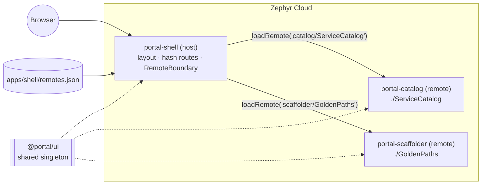

# Platform Portal: Module Federation on Zephyr Cloud

A small internal developer portal built as micro-frontends. A host shell composes two independently deployed remotes at runtime with Module Federation 2.0. Every app is deployed to **Zephyr Cloud through its default managed integration**, and changing one remote ships only that remote.

- **Live (production):** https://production-portal-shell-zephyr-mf-demo-vitorugoc-ze.zephyrcloud.app/
- **Demo video:** _link added after recording_
- **Design doc:** [docs/SDD.md](docs/SDD.md) · **Deployment:** [docs/deployment.md](docs/deployment.md) · **Zephyr feedback:** [docs/zephyr-feedback.md](docs/zephyr-feedback.md)



## What's in the repo

| Path | What it is |
|---|---|
| `apps/shell` | Host. Reads `remotes.json`, renders the nav, loads each page with `loadRemote()` inside an error boundary with Retry. |
| `apps/catalog` | Remote that exposes `./ServiceCatalog`: a searchable, filterable service table. |
| `apps/scaffolder` | Remote that exposes `./GoldenPaths`: pick a template, name the app, copy the `nx g` command. |
| `packages/ui` | `@portal/ui` design system (tokens, Button, Badge, Card, PageHeader), shared as an MF singleton and versioned with `nx release`. |
| `tools/portal-plugin` | `@portal/plugin`, an NX generator that scaffolds a new remote and registers it in the shell. |
| `e2e` | Playwright smoke and axe tests against production builds of all three apps. |
| `module-federation.shared.ts` | The one place that defines what's shared (React, React DOM, the UI kit). |

Stack: Rsbuild 2 + `@module-federation/rsbuild-plugin` 2.9 + `zephyr-rsbuild-plugin` 1.8, React 19, TypeScript (strict), NX 24 on pnpm workspaces, Rstest + Testing Library, Playwright, Biome, commitlint + lefthook.

## Run it locally

```sh
nvm use                # Node 24 (.nvmrc; engine-strict fails loudly on anything else)
corepack enable        # pnpm 10 from packageManager
pnpm install
pnpm dev               # shell :3000, catalog :3001, scaffolder :3002 (Zephyr disabled)
```

Open http://localhost:3000.

| Task | Command |
|---|---|
| Unit and component tests | `pnpm test` |
| Types | `pnpm typecheck` |
| Lint and format check | `pnpm lint` |
| e2e (builds everything, serves it, runs Playwright + axe) | `pnpm nx run portal-e2e:e2e` |
| Deploy everything to Zephyr (opens a browser login the first time) | `pnpm nx run portal-shell:build` |
| Scaffold a new remote | `pnpm nx g @portal/plugin:remote --name=incidents --label="Incidents"` |
| Release `@portal/ui` | `pnpm release` |

## How deployment works

1. `withZephyr()` is the last Rsbuild plugin in every app. On `build` it reads the Module Federation config, uploads the output to Zephyr and prints an immutable version URL. `dev` and `build:local` set `ZE_DISABLED=true`, so local work and CI checks never upload.
2. The shell's MF config only knows `localhost` URLs. `"zephyr:dependencies"` in `apps/shell/package.json` maps each remote key to a Zephyr app (`"catalog": "portal-catalog@workspace:*"`). At build time Zephyr rewrites the remotes to **tag URLs**, which always resolve to the newest matching remote version.
3. GitHub Actions runs `verify` on every PR: lint, typecheck, unit tests for affected projects, then e2e. A push to `main` also runs `deploy`, which is `nx affected -t build` with a Zephyr CI token. A remote-only change deploys only that remote, and the live shell picks it up without being rebuilt. A shell change also rebuilds the remotes first (build order), so they get fresh but identical versions.
4. Environments and rollbacks are pointer moves in the Zephyr dashboard. Nothing is rebuilt.

More detail, including what I'd add for PR previews and pinned releases, is in [docs/deployment.md](docs/deployment.md).

### Zephyr concepts used

- **Default cloud integration.** No BYOC provider; Zephyr hosts on its managed edge.
- **Immutable versions.** Every build gets its own permanent URL.
- **Remote dependencies.** `zephyr:dependencies` with the `workspace:*` selector, so no remote URL is hardcoded.
- **Tags and environments.** `production` follows `main`.
- **Rollback.** Instant, from the dashboard.
- **CI tokens.** `ZE_CI_TOKEN` in GitHub Actions, with the GitHub account linked under Git Providers.

### Mapping the pipeline to Harness

The pipeline is GitHub Actions because the repo is on GitHub, but it's deliberately plain shell steps:

- **`verify` → a CI stage.** Steps are `pnpm install --frozen-lockfile`, `pnpm lint`, `nx affected -t typecheck test` (with Harness's base/head SHAs in place of `nx-set-shas`), then `nx run portal-e2e:e2e`. The Playwright report becomes a stage artifact.
- **`deploy` → a second stage, gated on `verify` and on the branch being `main`.** `ZE_CI_TOKEN` comes from a Harness secret, and the step is `nx affected -t build --output-style=static`.
- **Promotion and rollback.** These stay in Zephyr (environments, rollback), so Harness doesn't need a CD stage for them. If the team wanted approvals, a Harness approval step could call Zephyr's environment promotion before production moves.

## Testing

TDD throughout: each behaviour was added as a failing test and then the code to pass it, usually in the same commit (see the history).

- **Unit and component tests** run on Rstest, with only the React plugin, so tests never federate or upload. The pure logic (filters, validation, command building) is tested as plain functions.
- **A contract test** in the shell checks every entry in `remotes.json` against:
  - the remote's package name
  - its MF `name` and `exposes`
  - the shell's `zephyr:dependencies` key
  - the build order

  A typo there would otherwise only show up as a deployed shell that can't find its remote.
- **e2e** (Playwright, against `build:local` output) checks that:
  - the shell composes both remotes
  - a blocked catalog is contained to its own page while the scaffolder keeps working
  - Retry recovers the catalog once it's back
  - axe reports no violations

The e2e found two real bugs:

- With MF's default `shareStrategy: 'version-first'`, the host fetches every remote at startup, so one remote being down blanked the whole shell. It's now `'loaded-first'`.
- The page had no `lang` attribute.

## Decisions

The [SDD](docs/SDD.md) has the full plan, phase by phase, with the spike results. The decisions that shaped the code are recorded as ADRs:

1. [Rsbuild + MF 2.0 + zephyr-rsbuild-plugin](docs/adr/0001-rsbuild-module-federation-zephyr.md)
2. [Thin NX; `build` is a deploy, so it is never cached](docs/adr/0002-thin-nx-build-is-deploy.md)
3. [Runtime remote registry instead of MF type generation](docs/adr/0003-runtime-remote-registry.md)
4. [Rstest over Vitest](docs/adr/0004-rstest-over-vitest.md)
5. [Zephyr selectors and a single production environment](docs/adr/0005-zephyr-selectors-and-production-env.md)

## How this was built

I used Claude Code as a pair throughout, and I'm describing the process because it's part of how I work.

1. **Grilling session.** Before any code, I had Claude list every open decision (stack, monorepo tooling, testing, CI, scope, commit conventions) as a dependency tree.
2. **Senior-engineer agent.** A second agent, prompted as a staff frontend-platform engineer, answered each round with rationale. A research agent read the Zephyr docs first, so the answers were grounded in the current plugin versions rather than memory.
3. **SDD and ADRs.** I reviewed the answers, kept or changed them, and turned the result into the SDD and ADRs in `docs/`. The SDD made it easy to work in small, reviewable steps.
4. **Phased TDD.** One branch and pull request per phase, merged with rebase so the small commits stay readable. Each behaviour started as a failing test.

**What I did myself:**
- approved the plan and the scope cuts
- every step that needed an account: the Zephyr login, the CI token, linking GitHub, and the dashboard environment and rollback
- recorded the demo

**What came out of real runs rather than generated text:**
- The running app was checked in a browser at every phase. That caught a table styling bug, and the e2e caught the resilience and accessibility bugs mentioned above.
- [docs/zephyr-feedback.md](docs/zephyr-feedback.md) was written during the work, as each problem came up.
