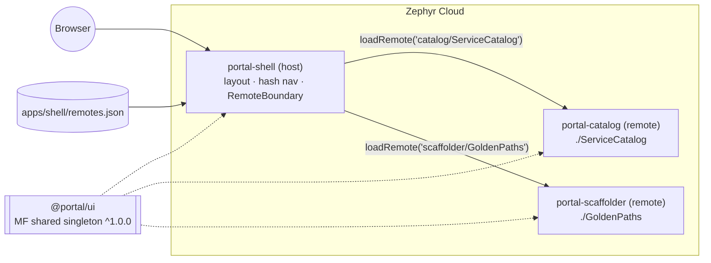
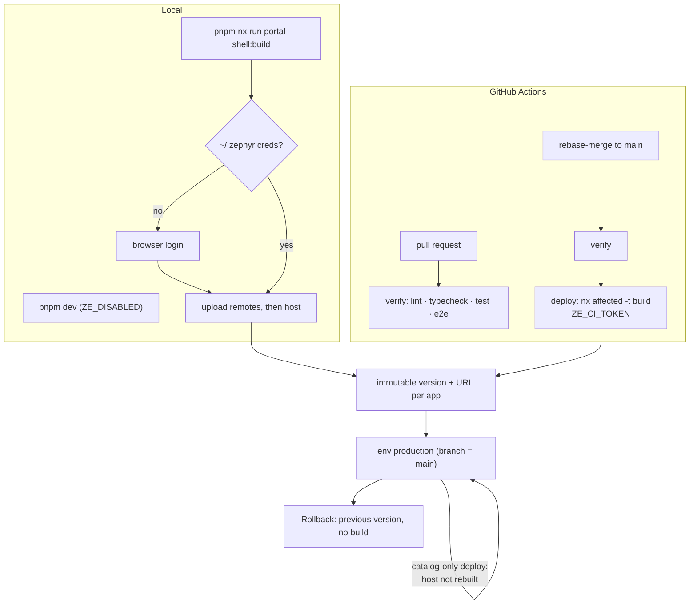

# Platform Portal: Software Design Document

Repo: `github.com/vitorugoc/zephyr-mf-demo` · Status: approved for implementation · Last updated: 2026-11-17

## 1. Context

The assignment: *"Deploy an application using Zephyr and Module Federation, relying on Zephyr's default Cloud integration."*

Deliverables:
- a public GitHub repo
- a short demo video of the deployment workflow and the running app
- a walkthrough plus feedback in the interview

Timebox: 2–3 days.

The role is platform-focused: shared React components, NX generators and golden paths, release automation, CI/CD, DX. So the app is a small internal developer portal, and the repo is built the way I'd build a platform repo.

## 2. Goals and non-goals

**Goals**
- A host and two remotes, plus a shared UI package. They are federated at runtime, each deployed to Zephyr Cloud, and each can be deployed on its own.
- CI deploys on every push to `main`. A change to one remote deploys only that remote, and the host picks it up without a rebuild.
- Rollback is shown live.
- TDD throughout, with small Conventional Commits in phases.
- Everything (code, UI copy, docs, commits, PRs) is in English.

**Non-goals**
- BFF/Lambda
- Terraform/OpenTofu
- Fastly or BYOC (we use Zephyr's default cloud)
- Harness (the README maps the pipeline to it instead)
- auth
- SSR
- npm publishing
- Storybook
- visual regression
- PR preview environments
- Renovate/Dependabot

## 3. Requirements (MoSCoW)

| | Requirement |
|---|---|
| **Must** | Shell, catalog, scaffolder and `@portal/ui` working locally and on Zephyr Cloud |
| **Must** | A failing remote is isolated, with a fallback and a retry |
| **Must** | GitHub Actions: `verify` on every PR and push, `deploy` on `main` |
| **Must** | TDD unit/component tests, one Playwright smoke test with an axe check |
| **Must** | README, this SDD, ADRs, `docs/zephyr-feedback.md`, a 4–5 minute demo video |
| **Should** | Independent remote deploy plus rollback on a `production` env (P6) |
| **Should** | NX generator `nx g @portal/plugin:remote` (P7) |
| **Should** | `nx release` for `@portal/ui`, with changelog and GitHub release (P8) |
| **Could** | `ZE_PUBLIC_ENV` badge in the shell, coverage report |
| **Won't** | Everything listed under non-goals |

## 4. Architecture



- **Registry.** `apps/shell/remotes.json` is the single source of truth for remotes ([ADR 0003](adr/0003-runtime-remote-registry.md)). The shell's MF `remotes` config, the nav and the routes are all generated from it.
- **Loading.** Pages load with `loadRemote()`. Each page is wrapped in its own `RemoteBoundary` (error boundary + Suspense + Retry), so one broken remote never takes down the shell.
- **Shared modules.** `react` and `react-dom` are singletons. `@portal/ui` is a singleton with `requiredVersion: '^1.0.0'`. It is consumed as TypeScript source (`exports` → `src/index.ts`) and has no build step.
- **Styling.** CSS Modules per component, plus design tokens as CSS custom properties in `@portal/ui/tokens.css`. No Tailwind, no CSS-in-JS.
- **Routing.** Hash routing (`#/catalog`) through a `useSyncExternalStore` hook. There is no router dependency, and deep links don't rely on a server-side SPA fallback.
- **Remote contract.** Every exposed module is a props-less page component, so the shell types them all as `RemotePage = { default: ComponentType }`. `dts: false` is set everywhere.
- **Zephyr resolution.**
  - At build time, `withZephyr()` reads the MF config and uploads the app as an immutable version.
  - It resolves the host's remotes through `zephyr:dependencies`, using the default selector URL mode ([ADR 0005](adr/0005-zephyr-selectors-and-production-env.md)).
  - The app UID is `{package name}.{repo}.{org}`. That's why app package names are unscoped and the repo name stays fixed.

### MF contract

| Remote key (MF `name`) | Package | Port | Exposes | Route / label | `zephyr:dependencies` (in shell) |
|---|---|---|---|---|---|
| `shell` (host) | `portal-shell` | 3000 | — | — | — |
| `catalog` | `portal-catalog` | 3001 | `./ServiceCatalog` | `catalog` / Service Catalog | `"catalog": "portal-catalog@workspace:*"` |
| `scaffolder` | `portal-scaffolder` | 3002 | `./GoldenPaths` | `golden-paths` / Golden Paths | `"scaffolder": "portal-scaffolder@workspace:*"` |

Host MF remote string: `` `${name}@http://localhost:${port}/mf-manifest.json` ``. The contract test (P5) checks this table against the code.

## 5. Decisions

| ADR | Decision |
|---|---|
| [0001](adr/0001-rsbuild-module-federation-zephyr.md) | Rsbuild + MF 2.0 + `zephyr-rsbuild-plugin`, with newer pinned versions than the docs show |
| [0002](adr/0002-thin-nx-build-is-deploy.md) | Thin NX. `build` = deploy (uncached), `build:local` for e2e, task-level build order |
| [0003](adr/0003-runtime-remote-registry.md) | Runtime `loadRemote()` from a JSON registry, no MF DTS, a contract test |
| [0004](adr/0004-rstest-over-vitest.md) | Rstest with only the React plugin, with Vitest as a timeboxed fallback |
| [0005](adr/0005-zephyr-selectors-and-production-env.md) | `workspace:*` selectors, one `production` env, deploy from `main` only |

Smaller decisions that don't need an ADR:
- strict TypeScript and Biome
- pnpm 10 through corepack
- Node 24 with `engine-strict`
- commitlint + lefthook
- rebase-merge PRs
- no coverage gate

## 6. Toolchain (exact pins, `save-exact=true`)

| Area | Package | Version |
|---|---|---|
| Runtime | Node (`.nvmrc`, `engines: ">=24 <25"`, `engine-strict=true`) | 24 |
| | pnpm (`packageManager`) | 10.34.9 |
| Monorepo | `nx` / `@nx/devkit` (generator only) | 24.0.6 |
| Build | `@rsbuild/core` | 2.3.3 |
| | `@rsbuild/plugin-react` | 2.1.1 |
| MF | `@module-federation/rsbuild-plugin` / `@module-federation/enhanced` (shell, runtime) | 2.9.3 |
| Zephyr | `zephyr-rsbuild-plugin` | 1.8.0 |
| UI | `react` / `react-dom` | 19.3.1 |
| | `@types/react` / `@types/react-dom` | 19.3.0 |
| Language | `typescript` | 6.0.3 |
| | `@types/node` | 24.19.2 |
| Lint/format | `@biomejs/biome` | 2.6.8 |
| Unit tests | `@rstest/core` | 0.12.6 |
| | `@testing-library/react` | 16.3.3 |
| | `@testing-library/dom` | 10.4.2 |
| | `@testing-library/user-event` | 14.6.12 |
| | `@testing-library/jest-dom` (matchers) | 7.0.1 |
| | `jsdom` | 31.0.1 |
| E2E | `@playwright/test` | 1.65.1 |
| | `@axe-core/playwright` | 4.14.0 |
| Commits | `@commitlint/cli` / `@commitlint/config-conventional` | 21.2.4 |
| | `lefthook` | 2.2.2 |

Root `package.json` also sets `"pnpm": { "onlyBuiltDependencies": ["nx", "@swc/core", "lefthook"] }`, adjusted to whatever pnpm reports.

## 7. Repo layout

```
zephyr-mf-demo/
├── .github/
│   ├── CODEOWNERS                  # one line per app, team names in comments
│   └── workflows/ci.yml            # verify + deploy
├── apps/
│   ├── shell/
│   │   ├── remotes.json            # registry (ADR 0003)
│   │   ├── module-federation.config.ts
│   │   ├── rsbuild.config.ts  rstest.config.ts  tsconfig.json  package.json
│   │   └── src/ index.ts bootstrap.tsx App.tsx RemoteBoundary.tsx
│   │            use-hash-route.ts load-remote-page.ts remotes.contract.test.ts
│   ├── catalog/
│   │   └── src/ index.ts bootstrap.tsx ServiceCatalog.tsx filter-services.ts data/services.ts
│   └── scaffolder/
│       └── src/ index.ts bootstrap.tsx GoldenPaths.tsx validate-name.ts
│                build-generate-command.ts data/golden-paths.ts
├── packages/ui/                    # @portal/ui: Button Badge Card PageHeader tokens.css
├── tools/portal-plugin/            # @portal/plugin: generators.json, src/remote/{generator,schema,files}
├── e2e/                            # portal-e2e: playwright.config.ts, smoke.spec.ts
├── docs/  SDD.md  adr/  zephyr-feedback.md  demo-script.md
├── biome.json  commitlint.config.ts  lefthook.yml  nx.json  tsconfig.base.json
├── package.json  pnpm-workspace.yaml  .npmrc  .nvmrc  .gitignore  LICENSE  README.md
```

Each app's `index.ts` contains only `import('./bootstrap')`.

**Scripts per app:**

| Script | Command | NX cache |
|---|---|---|
| `dev` | `ZE_DISABLED=true rsbuild dev` | — |
| `build` | `rsbuild build`. This deploys to Zephyr. | `cache: false` |
| `build:local` | `ZE_DISABLED=true rsbuild build` | cached |
| `preview` | `rsbuild preview` | — |
| `test` | `rstest run` | cached |
| `typecheck` | `tsc --noEmit` | cached |

**Root scripts:** `dev` (`nx run-many -t dev --parallel=5`), `lint` (`biome check .`), `deploy` (`nx run-many -t build`), `prepare` (`lefthook install`).

**`.gitignore`:** `node_modules`, `dist`, `.nx`, `coverage`, `test-results`, `playwright-report`, `*.log`, `.env*`, `.work/`.

## 8. CI/CD and deployment workflow

`.github/workflows/ci.yml`:

- **`verify`** runs on PRs and on pushes to `main`, with job env `ZE_DISABLED: "true"`.
  1. checkout with `fetch-depth: 0`
  2. `pnpm/action-setup@v4`
  3. `actions/setup-node@v4` with `node-version-file: .nvmrc` and `cache: pnpm`
  4. `pnpm install --frozen-lockfile`
  5. `nrwl/nx-set-shas@v4`
  6. `pnpm nx affected -t lint typecheck test`
  7. `build:local` for all apps, then the Playwright smoke
- **`deploy`** runs only on push to `main` and needs `verify`.
  - env: `ZE_CI_TOKEN: ${{ secrets.ZEPHYR_CI_TOKEN }}`, `ZE_FAIL_BUILD: "true"`
  - command: `pnpm nx affected -t build`
  - `ZE_SECRET_TOKEN` is never set, because it is deprecated and overrides `ZE_CI_TOKEN`.



**Branching:**
- P0 is pushed straight to `main`.
- From P1 on, each phase gets one branch and one PR (`gh pr create`, English title and body: what / why / how verified).
- PRs are merged with **Rebase and merge** so the small commits survive.
- Branch protection on `main` requires `verify` from P1 on.

**Commits:**
- Conventional Commits, enforced by commitlint and lefthook. Lefthook also runs `biome check --staged --write`.
- Scopes: `shell, catalog, scaffolder, ui, e2e, tools, ci, repo, docs, deps, release`.
- One TDD cycle per commit, with the test and the implementation together. Refactors get their own commits.
- Real timestamps, no AI co-author trailer.

## 9. Phase plan

Total is about 27h. **Cut line:** P0–P6 plus P9 is a complete submission. P7 and P8 are timeboxed extras.

### P0 Skeleton and verify CI · branch: `main` (direct) · 2h

- **Goal:** a workspace where lint, typecheck, test and commit rules are enforced from the first commit.
- **Scope:**
  - pnpm workspace, NX, `tsconfig.base.json` (`strict`, `noUncheckedIndexedAccess`, `verbatimModuleSyntax`, `moduleResolution: bundler`, `jsx: react-jsx`)
  - Biome
  - commitlint and lefthook
  - `.nvmrc`, `.npmrc`, `.gitignore`, LICENSE (MIT), CODEOWNERS
  - the `verify` job
  - repo created with `gh repo create`
- **Acceptance:**
  - Running `pnpm install` on Node 16 fails on the engine check. On Node 24 it succeeds.
  - A commit with message `bad message` is rejected locally.
  - `verify` is green on GitHub.
- **Tests first:** none, since this is tooling only. The commit hook is the check.
- **Commits:**
  - `chore(repo): initialize pnpm workspace with nx, typescript and biome`
  - `chore(repo): enforce conventional commits with commitlint and lefthook`
  - `chore(repo): add license, codeowners and gitignore`
  - `ci: add verify workflow for lint, typecheck and test`

### P1 Zephyr spike (de-risk) · `ci/p1-zephyr-spike` · 3h

- **Goal:** prove the whole pipeline on day 1 with a "hello" shell and catalog. These evolve into the real apps; they are not throwaway.
- **Scope:**
  - `apps/shell` and `apps/catalog` with MF + Zephyr config
  - Rstest set up in catalog
  - first local deploy (the user does the browser login)
  - CI token stored as the `ZEPHYR_CI_TOKEN` secret
  - `deploy` job
  - Zephyr friction logged in `docs/zephyr-feedback.md`
- **Acceptance:**
  - The shell's Zephyr URL renders the catalog page.
  - The `deploy` job is green and prints version URLs.
  - Spike items (a)–(g) are filled in (§10).
- **Tests first:**
  1. `ServiceCatalog` renders the "Service Catalog" heading. This is also the check for spike item (g).
- **Commits:**
  - `feat(catalog): expose ServiceCatalog page via module federation`
  - `feat(shell): load catalog remote at runtime`
  - `build(repo): deploy apps with zephyr rsbuild plugin`
  - `ci: deploy affected apps to zephyr on push to main`
  - `docs: record p1 spike results`

### P2 `@portal/ui` · `feat/p2-ui` · 2h

- **Goal:** a shared design system used as an MF singleton.
- **Acceptance:**
  - Shell and catalog render ui components.
  - The browser loads `@portal/ui` once (visible in the network panel).
  - All tests pass.
- **Tests first:**
  1. `Button` has its accessible name and calls `onClick`
  2. `Badge` exposes its `tone` through `data-tone` (`neutral | success | warning | danger`)
  3. `Card` renders its title as a heading
  4. `PageHeader` renders an `h1` and a description
- **Commits:**
  - `feat(ui): add design tokens as css custom properties`
  - `feat(ui): add Button component`
  - `feat(ui): add Badge with status tones`
  - `feat(ui): add Card and PageHeader`
  - `build: share @portal/ui as a federation singleton`

### P3 `portal-catalog` · `feat/p3-catalog` · 2.5h

- **Goal:** a searchable service catalog.
- **Data:** `data/services.ts` holds 8 fictional services: `{ id, name, ownerTeam, tier, status, repo, tags }`. The table deliberately leaves out the `ownerTeam` column; P6 adds it.
- **Acceptance:**
  - Search and tier filter work in standalone mode (`:3001`) and inside the shell.
- **Tests first:**
  1. `filterServices` with an empty query returns all services
  2. name matching is case-insensitive
  3. filters by tier
  4. combines query and tier
  5. the page lists services with status badges
  6. typing narrows the rows
  7. the empty state "No services match"
- **Commits:**
  - `feat(catalog): add typed seed data for services`
  - `feat(catalog): filter services by name and tier`
  - `feat(catalog): render service table with status badges`
  - `feat(catalog): add search and tier filter controls`
  - `feat(catalog): show empty state when no service matches`

### P4 `portal-scaffolder` · `feat/p4-scaffolder` · 2.5h

- **Goal:** a golden-paths page that builds an `nx g …` command.
- **Data:** `data/golden-paths.ts` holds 4 golden paths:
  - `react-remote`
  - `node-bff-lambda`
  - `shared-react-lib`
  - `terraform-module`

  Everything except `react-remote` is labelled "example".
- **Acceptance:**
  - Works standalone on `:3002`.
  - Deployed as its own Zephyr app.
- **Tests first:**
  1. `validateName` accepts kebab-case names of 3–30 characters
  2. it rejects uppercase, spaces, leading digits or dashes, and names that are too short or too long
  3. `buildGenerateCommand` returns `<generator> --name=<name>`
  4. the page lists all golden paths
  5. a valid name shows the command
  6. an invalid name shows an error and hides the command
  7. Copy calls `navigator.clipboard.writeText` (stubbed with `rs.fn`)
- **Commits:**
  - `feat(scaffolder): add golden path seed data`
  - `feat(scaffolder): validate generated app names`
  - `feat(scaffolder): build nx generate command from template and name`
  - `feat(scaffolder): expose GoldenPaths page via module federation`
  - `feat(scaffolder): copy generated command to clipboard`

### P5 Shell composition and resilience · `feat/p5-shell-composition` · 3.5h

- **Goal:** the shell is fully driven by the registry, and failures stay isolated.
- **Scope:**
  - `remotes.json`
  - `App` receives `remotes` and `load` as props, wired up in `bootstrap.tsx`
  - `RemoteBoundary`
  - `useHashRoute`
  - the contract test
  - the e2e project and its CI step
- **Acceptance:**
  - Blocking `:3001` shows the catalog fallback while Golden Paths still works.
  - Retry recovers once the remote is back.
  - axe reports zero violations.
  - The e2e smoke runs in `verify`.
- **Tests first:**
  1. contract: every registry entry matches its remote's MF `name` and `exposes`, and the shell's `zephyr:dependencies`
  2. `useHashRoute` reads the hash and updates on `hashchange`
  3. an empty hash falls back to the first registry route
  4. `RemoteBoundary` shows loading text while pending
  5. it renders the page once loaded
  6. it shows a `role="alert"` naming the remote when loading fails
  7. Retry calls `load` again and renders on success
  8. `App` renders nav from the registry, and "Page not found" for unknown routes
  9. e2e: the composed portal renders
  10. e2e: a catalog outage isolates to the catalog
  11. e2e: no axe violations
- **Commits:**
  - `feat(shell): derive federation remotes from registry`
  - `test(shell): add contract test for registry, exposes and zephyr dependencies`
  - `feat(shell): add hash routing hook`
  - `feat(shell): isolate remote failures with retryable boundary`
  - `feat(shell): render navigation and pages from registry`
  - `test(e2e): add smoke test for composed portal and remote outage`
  - `test(e2e): assert no axe violations on composed portal`
  - `ci: run e2e smoke in verify job`

### P6 Environments, independent deploy, rollback · `feat/p6-independent-deploy` · 2h

- **Goal:** show the core value of Zephyr + MF.
- **Scope:**
  - In the dashboard: create the `production` environment with condition branch = `main`.
  - Ship a catalog-only change.
  - Roll back.
  - Write a README section on environments, rollback and how PR previews would work.
- **Acceptance:**
  - The Actions log for the merge shows only `portal-catalog` built.
  - The dashboard shows a new catalog version and the shell version unchanged.
  - The `production` URL shows the new column.
  - After Rollback the column is gone and no build ran.
- **Tests first:**
  1. the catalog table shows an "Owner team" column
- **Commits:**
  - `feat(catalog): show owner team column`
  - `docs: document zephyr environments, independent deploys and rollback`

### P7 NX remote generator · `feat/p7-remote-generator` · 4h (timebox)

- **Goal:** a golden path that actually works: `pnpm nx g @portal/plugin:remote --name=incidents --label="Incidents"`.
- **Behaviour:**
  - Creates `apps/<name>` (package `portal-<name>`, version `0.1.0`, the full MF/Zephyr/Rstest setup, `dts: false`, the same shared config as the other apps).
  - Appends to `remotes.json`, with port = highest existing port + 1.
  - In the shell's `package.json`, adds the remote to `zephyr:dependencies` and to the build `dependsOn` projects.
  - Only `updateJson` is used, with no AST edits.
  - The name rule is the same one-line regex the scaffolder uses. It is duplicated on purpose, because a shared package for a single regex isn't worth it.
- **Acceptance:**
  - `--dry-run` lists the expected files.
  - After a real run, `pnpm nx run-many -t test typecheck` is green, contract test included.
  - The generated app is shown in the demo and not committed.
- **Tests first** (`createTreeWithEmptyWorkspace` from `@nx/devkit/testing`):
  1. creates the app files with package name `portal-<name>`
  2. appends a registry entry with the next free port
  3. updates `zephyr:dependencies` and the build `dependsOn`
  4. rejects an invalid name
  5. rejects a duplicate name
- **Commits:**
  - `feat(tools): scaffold remote app files from template`
  - `feat(tools): register generated remote in shell registry`
  - `feat(tools): add generated remote to zephyr dependencies and build order`
  - `feat(tools): reject invalid or duplicate remote names`
  - `feat(scaffolder): point react-remote golden path to the real generator`

### P8 `nx release` for `@portal/ui` · `chore/p8-ui-release` · 2h (timebox)

- **Goal:** semver, changelog and a GitHub release for the shared library, with no npm publish.
- **Config** in `nx.json`:
  - `release.projects: ["@portal/ui"]`, `projectsRelationship: "independent"`
  - `releaseTag.pattern: "{projectName}@{version}"`
  - `version.conventionalCommits: true`
  - `changelog.projectChangelogs.createRelease: "github"`, `workspaceChangelog: false`
  - Check these key names against the NX 24 docs.
- **Commands:**
  - `pnpm nx release --first-release --skip-publish --dry-run` first, then without `--dry-run`. Run locally, authenticated through `gh`.
- **Acceptance:**
  - `packages/ui/CHANGELOG.md` exists.
  - The `@portal/ui@1.1.0` tag and GitHub release exist.
  - Remotes built against `^1.0.0` still share a single copy at runtime.
- **Tests first:** none; this is config. The dry run is the check.
- **Commits:**
  - `build(repo): configure nx release for @portal/ui`
  - `chore(release): publish @portal/ui 1.1.0` (generated by NX)
- **If over the timebox:** demote to Could and describe the plan in the README.

### P9 Docs, feedback, demo · `docs/p9-docs-and-demo` · 3h

- **README:**
  - goal and video link
  - Mermaid architecture diagram
  - quickstart (`nvm use`, `corepack enable`, `pnpm install`, `pnpm dev`)
  - how deployment works
  - Zephyr concepts used
  - Harness mapping (about 10 lines)
  - "How this was built", about 10 factual lines:
    - grilling session → senior-agent answers → SDD and ADRs → phased TDD with Claude Code
    - what I decided and verified myself
    - the raw Q&A is not in the repo
- **`docs/zephyr-feedback.md`:**
  - timestamped friction log
  - what worked
  - docs gaps (for example version drift: 1.2.0/2.8.0 in the docs vs 1.8.0/2.9.3 on npm)
  - suggestions
  - feedback on the assignment
- **`docs/demo-script.md`:** the timed outline below.
- **Video:** QuickTime at 1080p, then `ffmpeg … -c:v libx264 -crf 26`, uploaded as unlisted on YouTube.
- **Timed outline:**

  | Time | Segment |
  |---|---|
  | 0:00 | goal and diagram |
  | 0:30 | `nx graph` and the registry |
  | 1:00 | `pnpm dev` |
  | 1:30 | merge → verify → deploy log |
  | 2:20 | dashboard |
  | 2:50 | catalog-only deploy |
  | 3:40 | rollback |
  | 4:00 | remote outage, fallback and retry |
  | 4:20 | generator |
  | 4:40 | feedback |

  CI waits are cut out of the video, and the video says so.
- **Acceptance:** a reviewer can clone the repo and run it from the README alone. The video is under 5 minutes.
- **Commits:**
  - `docs: write readme with architecture and deployment guide`
  - `docs: add zephyr feedback`
  - `docs: add demo script`
  - `docs: link demo video`

## 10. Spike checklist (fill in after P1)

If a result changes a decision, supersede the matching ADR.

| # | Check | Fallback if it fails | Result |
|---|---|---|---|
| a | Rsbuild 2.3.3 + MF 2.9.3 + zephyr 1.8.0 build and deploy | Drop to the newest combination that works; note it in the feedback | Pass. catalog #1–#2 and shell #4–#5 deployed. One transient 403 on the shell's first build (see feedback). |
| b | `ZE_DISABLED=true` keeps `dev` and `build:local` from uploading or prompting | Add `withZephyr()` only when our own flag is set (`ZEPHYR_DEPLOY=1` on `build`) | Pass. Prints "The bundle is not deployed. Zephyr is disabled" and never asks for auth. |
| c | `loadRemote()` resolves remotes that Zephyr rewrote | Static `import()` through `React.lazy`, with typings in `remotes.d.ts` | Pass. The deployed shell renders the catalog; Zephyr rewrote the remote to the branch tag URL (`t-web-ci-p1-zephyr-spike-…/remoteEntry.js`). |
| d | `workspace:*` resolves in CI (CI token user, `main`) | `@latest` | Pass locally (same branch and user). CI: pending first deploy from `main`. |
| e | A catalog-only deploy shows up in the un-rebuilt host and in `production` | `dependencyUrlMode` docs, ask Zephyr support, demo with a tag | Pending (P6). |
| f | `nx show projects --affected` leaves out the shell after a catalog-only change | Deploy step: `affected --exclude=portal-shell`, then the shell only if it is affected | Pass. The project graph has no shell → catalog edge; the task graph still builds the catalog first. |
| g | Rstest does not pull the MF or Zephyr plugins into tests | Configure Rstest's own `plugins` with only `pluginReact()` | Pass by design. `rstest.config.ts` lists only `pluginReact()`, so the adapter isn't needed and was dropped. |

## 11. Risks

| Risk | Mitigation |
|---|---|
| Plugin versions are newer than the docs | P1 spike on day 1, before any features |
| An NX cache hit skips the Zephyr upload | `build` has `cache: false` ([ADR 0002](adr/0002-thin-nx-build-is-deploy.md)) |
| Two copies of the MF runtime if `@module-federation/enhanced` drifts | Pin to 2.9.3, check with `pnpm why @module-federation/runtime` |
| MF can't infer `requiredVersion` from `workspace:*` | Set `requiredVersion` explicitly; ui starts at 1.0.0 |
| Zephyr cache delay (1 min to 1 h) | CI never gates on deployed URLs; record P6 early on day 3 |
| Rstest is 0.x | Fall back to Vitest after 1h ([ADR 0004](adr/0004-rstest-over-vitest.md)) |
| NX 24 `release` config keys may differ | `--dry-run` first; P8 is timeboxed |
| New terminals default to Node 16 | `.nvmrc`, `engines` and `engine-strict` fail loudly; README says `nvm use` |
| Inline env vars in scripts only work on POSIX | Acceptable: macOS and Ubuntu CI; documented |
| Scope creep from the job extras | P7 and P8 start only after P0–P6 are deployed |

## 12. Definition of Done

- [ ] The public repo builds from a clean clone by following the README alone.
- [ ] Shell, catalog and scaffolder are live on Zephyr Cloud. The `production` env exists. Rollback was shown.
- [ ] `verify` and `deploy` are green on `main`. A catalog-only merge deployed only the catalog.
- [ ] Every behaviour in §9 has a test committed alongside it. The e2e smoke and the axe check pass.
- [ ] Lint, typecheck and test are green; there are no `any` escapes or disabled rules without a comment.
- [ ] Spike checklist filled in, ADRs up to date, `docs/zephyr-feedback.md` complete.
- [ ] The video (≤5 min) is linked from the README.
- [ ] All content is in English. History is a linear series of Conventional Commits with no AI co-author trailers.
